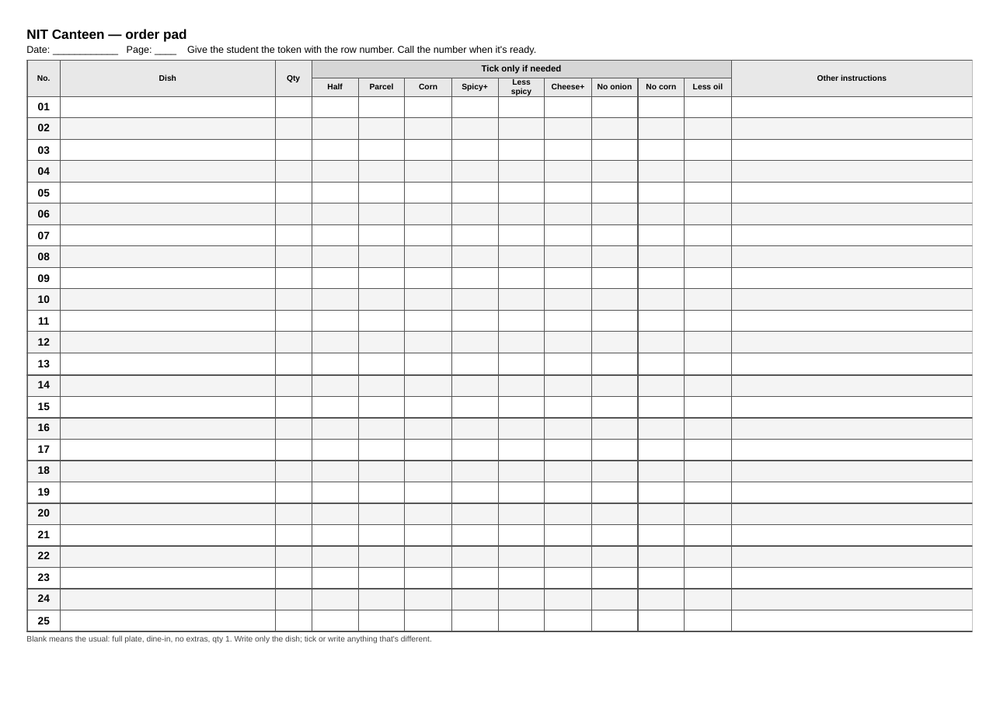

# NIT Canteen: order mix-up checker, numbered order pad, batch preparation and photo import

**Place:** NIT Canteen, NIT Jamshedpur campus (night canteen)
**Person:** Kamal Singh ("Canteen Bhaiya"), order-taker. He takes orders, packs, garnishes and calls out names; a second person cooks.
**Dates:** 17–18 Nov 2026
**By:** Rani

## The problem
During the 10 pm – 1 am rush, students order from the sitting area, and almost every order is customised: half/full, parcel, extra spicy, extra cheese, no onion, no corn, less oil. Kamal writes each order in shorthand on a notepad but **never writes who it's for**, and **most spoken extras never get written down**. Two things can go wrong:

1. **The dish is made wrong:** an extra like "spicy" gets lost between Kamal and the cook.
2. **The right dish goes to the wrong person:** two students order the same thing, and the plates get swapped or served out of turn.

He's surprisingly good at keeping track from memory, but everything depends on that memory.

More detail: [research.md](research.md) · [fieldwork.md](fieldwork.md) · raw data: [data.csv](data.csv)

## The solution (physical, not digital)
**A numbered order pad + matching numbered tokens.**
- Each order goes on a numbered row of the pad. Kamal writes **only the dish**. Half, parcel and extras are ticked **only if needed**, because a blank means the usual order (full plate, dine-in, no extras, qty 1). Anything else goes in "Other instructions".
- The student gets a token with the same number. When the food is ready, Kamal calls the number and takes the token back.
- The written row tells the cook exactly what to make, which addresses problem 1. The token number links the plate to the student, which addresses problem 2.
- Batch cooking hint: when 4+ students order the same dish with no customization, the cook may make those orders together (the canteen's own rule), but each plate still goes out under its own number.
- No phones, tablets, printers or digital ordering during the rush. Kamal is packing and garnishing between orders, so anything that needs typing would add work.

## What the tool does
`canteen_tokens.py` supports that system using the data I collected:

1. **Validates the CSV without crashing.** Every problem is reported with its line number, and valid rows keep being processed.
2. **Finds potential mix-up risks:** the same dish written 2+ times on the same notepad page. Every pair of such orders is classified:
   - **Customization conflict:** a known difference in portion, parcel/dine-in or extras. Confusing them means someone gets the wrong food.
   - **Identification / delivery ambiguity:** identical as recorded. The food is right, but it could go to the wrong student or out of turn.
   - **Can't classify:** no known difference, but a portion or extra is unreadable, so it could be either.

   These are **potential risks, not confirmed mistakes.**
3. **Writes a numbered token slip** for every readable order (`slips.txt`). Each slip shows its `data.csv` row so it can be traced to the notepad photo.
4. **Recommends a token inventory** from timestamped orders: the most orders outstanding at once, × 1.25, rounded up. If there aren't enough timestamped orders, it says so. It never generates timestamps or assumes a peak.
5. **Suggests batch preparation** (`order_clustering.py`) by applying the canteen's own cooking rule. It writes `batch_report.csv` and `individual_orders.csv`. [Details below.](#batch-preparation)
6. **Generates the printable order pad** (`order_pad.html`, one A4 landscape page, 25 numbered rows):
   - Columns: No. | Dish | Qty | **Tick only if needed** (Half, Parcel, then the extras) | Other instructions.
   - Most orders need just the dish written. A tick is only for something different from the usual.
   - Rows are shaded alternately so a row is easy to follow across a busy page.
   - There's no name column: the token number already links the order to the student.
7. **Imports a filled pad from a photo (optional)** (`ocr_app.py` + `order_ocr.py`): upload a photo, check every row, **Confirm and Save** to `data.csv`, and see batch suggestions from the existing `cluster_orders()`. [Details below.](#reading-a-filled-pad-from-a-photo)



### How the risk percentage is calculated
- **Readable orders** = rows where both `item` and `variant` can be read. Rows 4, 9 and 19 have an unreadable dish and are left out of both the numerator and the denominator.
- **Risk %** = readable orders whose page + dish appears 2 or more times ÷ readable orders.
- On my data: **8 of 18 = 44%**. The breakdown counts orders by the kind of pair they're in. An order can be in both kinds, so those two counts may overlap.
- "Same dish" uses my reading of the notepad. Dishes I wasn't sure of are marked `(?)` and only match other `(?)` readings of the same word.

### Where the tick boxes come from
- **From the data:** extras written 2+ times in `data.csv`. Only **Corn** (2) qualifies. Garlic and "Mixed" appear once each, so they don't get a box.
- **From my observations at the canteen:** Spicy+, Less spicy, Cheese+, No onion, No corn, Less oil. Students ask for these, but Kamal rarely writes them down, so they aren't in the data.
- Anything else goes in **Other instructions**.

## Batch preparation
### The rule
This is the canteen's existing practice, from my conversation with the staff (see [fieldwork.md](fieldwork.md)):
- 4 or more students order the same dish with **no customization** → the cook may prepare those orders together in one batch.
- Fewer than 4 such orders → prepared individually.
- Orders with any customization → prepared separately, never combined automatically.
- Different dishes are never grouped.
- One batch holds **at most 6 plates**, and **half and full plates can be combined**. The cook confirmed both when I asked.

**A batch means cooking together, nothing more.** Every portion keeps its original order/token number and is plated, packed and handed over separately.

### How the clustering works (plain grouping, no ML)
1. **Normalise the dish name:** variant + item, lower case, single spaces. "Veg  Fried Rice" and "veg fried rice" match. A reading I wasn't sure of keeps a `(?)` marker, so `noodles?` never merges with a certain `noodles`.
2. **Set aside orders that can't be batched,** each with a reason:
   - Dish name missing or unreadable → individual.
   - Anything written in `modifications` → **customized**, individual.
   - `modifications` column missing from the file → customization **unknown**, individual. This is the safe choice: an unknown order is never batched.
3. **Group the remaining orders** by notepad page + dish. "Same page" is the default scope, because orders on different pages probably weren't waiting at the same time.
4. **Check plates.** An order whose `qty` is unknown can't be checked against the 6-plate limit, so it's prepared individually. So is one order of more than 6 plates.
5. **4 or more orders left in a group** → fill batches **in the order the orders were taken**, up to 6 plates each. Any leftover set of 4+ orders becomes another batch, and fewer than 4 are prepared individually. Example: 10 single plates → batch of 6 + batch of 4; 9 → batch of 6 + 3 individual.
6. **The 4+ rule counts orders (students), not plates.** One student ordering 4 plates isn't a batch. Total plates are reported for each batch.
7. **Original order IDs** are kept exactly as written, in their original order. Every order appears in exactly one of the two reports.
8. **No time window is used to form batches.** If every order in a batch has `time_ordered`, the report shows how many minutes apart they were ordered, and adds a note if that's over `REVIEW_WINDOW_MIN` (10). This is only a prompt to check, not a validated rule.

### Settings (top of `order_clustering.py`)
| Setting | Default | Meaning |
|---|---|---|
| `MIN_BATCH_SIZE` | 4 | orders needed for a batch suggestion: change it here only |
| `MAX_BATCH_PLATES` | 6 | most plates in one batch (confirmed by the cook) |
| `ALLOW_CUSTOMIZED_IN_BATCH` | False | the canteen's rule keeps customized orders separate |
| `SEPARATE_PACKING` | True (always) | the script refuses to run if this is set to False |
| `PRESERVE_ORDER_NUMBERS` | True (always) | the script refuses to run if this is set to False |
| `GROUP_BY_PAGE` | True | only batch orders written on the same notepad page |
| `SPLIT_BY_PORTION` | False | the cook confirmed half and full plates can be combined |
| `REVIEW_WINDOW_MIN` | 10 | only used to comment on timestamped batches |

### Result on my data
- **No batch is suggested.** No page has 4+ uncustomized orders of one dish. All 21 orders go to `individual_orders.csv`:
  - 11 with too few compatible orders
  - 4 with an unreadable quantity (rows 8, 10, 15, 20)
  - 3 customized (rows 11, 12, 13)
  - 3 with an unreadable dish (rows 4, 9, 19)

  `batch_report.csv` has only its header row.
- **The scope doesn't change it either.** With `GROUP_BY_PAGE = False` (as if all 21 orders were open at once), veg noodles rows 1, 8, 18 and 20 would match. But rows 8 and 20 have an unreadable quantity, so only 2 orders can be checked against the 6-plate limit, and there's still no batch.
- **Time window:** not analysed. None of these orders have `time_ordered`.

## Reading a filled pad from a photo
After a rush, Kamal still writes on paper. Someone then photographs the filled pad and the app turns it into data: no typing whole orders into an app during the rush.

```
Upload photo → read the form → CHECK AND CORRECT every row → Confirm and Save → data.csv → cluster_orders() → batch + individual preparation
```

### How the photo is read
1. **Find and straighten the table.** The grid lines form one connected block of ink, so the app finds that block, takes its 4 corners and straightens it. This handles a tilted or angled photo, sideways and upside-down photos, and uneven light (thanks to adaptive thresholding).
2. **Find the grid.** The order number is **never read from the handwriting**. It comes from the row's position on the printed pad. The pad's columns are read from `order_pad_layout.json`, which `canteen_tokens.py` writes whenever it prints the pad.
3. **Tick boxes** (Half, Parcel and the extras) use plain image processing, not AI: the share of dark pixels in each cell. A clear tick counts as ticked; a faint mark is flagged as "faint mark" for the user to decide. Completely empty rows are ignored.
4. **Handwriting** (Dish, Qty, Other instructions) is read by a vision API **only if a key is set**: `GEMINI_API_KEY` (Google Gemini, which has a free tier, used first) or `ANTHROPIC_API_KEY` (paid). The key is never stored in the code. Without a key, or if the service fails, those fields stay blank, and the screen shows a picture of each row so the user types them. Standard Tesseract OCR isn't used, because it isn't reliable on handwriting.

### Human verification (mandatory)
The verification screen shows:
- the original photo
- an editable table of every row read (rows can be fixed, added or deleted)
- a **Check** column for anything doubtful (faint marks, unsure readings, writing that still needs typing)
- a picture of each flagged row

Nothing is saved until **Confirm and Save** is pressed. Saving is refused if:
- a row has no dish, or a bad quantity, or two rows share an order number;
- **writing was seen on the photo but the field was left blank.** Unknown information can't quietly become "no customization". Type it, or write `?`, which keeps the order out of batches.

### What gets saved
- **Only confirmed rows,** appended to `data.csv` with its existing columns. The original rows are never changed.
- The pad's order number is kept in `row_id` as date/page/number (e.g. `2026-11-19/p1/07`), and `source` is `orderpad_<date>_p<page>`, so each pad page is its own group.
- Half → `portion`, Parcel → `parcel`, and ticked extras + Other → `modifications`. A blank Qty means 1, as printed on the pad.
- **Duplicates are blocked:** importing the same page twice saves nothing the second time.

After saving, the confirmed orders go straight to the existing `cluster_orders()` with the same rules (4+ orders, max 6 plates, customized orders separate, every order keeps its number). The screen shows Batch Preparation, Individual Preparation, downloadable CSVs, and counts of extracted, verified, saved, batched and individual orders.

### Run it
```bash
pip install -r requirements.txt
streamlit run ocr_app.py
```
Optional, so the handwriting is read automatically. Use your own key and never commit it. **Free option:** create a Gemini key at Google AI Studio (aistudio.google.com, "Get API key"), then:
```bash
export GEMINI_API_KEY=your-key               # Git Bash / Linux / macOS
$env:GEMINI_API_KEY="your-key"               # Windows PowerShell
```
`ANTHROPIC_API_KEY` works the same way (paid). Free-tier requests are rate-limited, so if you see a 429 message, wait a minute. Google's free tier may use what you send to improve its products. The pad has no student names, but check this is acceptable.
Print the pad from `order_pad.html` first. If the tick boxes ever change, reprint it, so the printed pad matches `order_pad_layout.json`.

### How it was tested
- **There are no real filled-pad photos yet,** so the tests use clearly labelled **synthetic** photos in `tests/fixtures/`, made by `tests/make_synthetic_fixtures.py`. That script prints the real pad, writes 8 made-up orders in a script-style font, and turns it into a tilted, angled, unevenly lit "phone photo" on a dark desk. These are test images, not data, and are never saved to `data.csv`.
- On these photos, every tick is read in the right row and column, even when the photo is tilted, sideways or upside down. The faint mark is flagged, a blank pad gives 0 rows, and a non-pad image gives a clear error.
- **The app itself was tested in a browser:**
  - uploading the photo shows the verification table;
  - Confirm and Save is refused while dishes are missing;
  - after the dishes were typed, 8 orders were saved;
  - the batch shown was veg maggi 01, 02, 03, 04, 06 (6 plates), with 05, 07 and 08 individual;
  - importing the same photo again saved nothing.
- **Still needed:** a real photo of a pad filled in by hand with a normal pen. The ink thresholds (`TICK_INK`, `UNSURE_BAND`, `TEXT_INK` at the top of `order_ocr.py`) were tuned on synthetic images only.

## How to run
Needs Python 3.8+. No packages to install.

```bash
python canteen_tokens.py            # reads data.csv in this folder
python canteen_tokens.py other.csv  # or any CSV with the same columns
python order_clustering.py          # batch preparation on its own
python -m unittest -v               # runs all 91 tests
streamlit run ocr_app.py            # photo import (pip install -r requirements.txt first)
```

Open `order_pad.html` in a browser and print it (A4, landscape).

### What the CSV checks catch
| Problem | What happens |
|---|---|
| File missing, empty, or not UTF-8 | Clear error message, exit code 1 (no traceback) |
| Missing `source`, `item` or `variant` column | Clear error: these are needed to analyse anything |
| Any other column missing | NOTE, treated as blank, analysis continues |
| Row with more or fewer values than the header (e.g. an unquoted comma) | SKIPPED with its line number, because the columns can't be trusted |
| Empty item/variant, bad portion, qty not a whole number ≥ 1, parcel not Y/N | WARNING with line number; the row is still used for what can be read |
| Time not HH:MM, served before ordered, served without ordered | WARNING; that row isn't used for the token count |
| Blank `modifications` | Not an error: it means no extras were recorded |

### Settings (top of the script)
| Setting | Default | Meaning |
|---|---|---|
| `MIN_LOOKALIKE` | 2 | times a dish must appear on one page to count as a risk group |
| `TOKEN_BUFFER` | 1.25 | safety buffer on the busiest moment |
| `MIN_TIMED_ROWS` | 5 | timestamped orders needed before recommending tokens |
| `NEXT_DAY_BEFORE` | 12 | times before 12:00 are treated as after midnight |
| `PAD_ROWS` | 25 | numbered rows per printed pad |
| `MIN_DATA_EXTRA` | 2 | times an extra must appear in the data to get a tick box |
| `MAX_TICK_BOXES` | 8 | most tick boxes on the pad |
| `OBSERVED_EXTRAS` | Spicy+, Less spicy, Cheese+, No onion, No corn, Less oil | extras from my observations |

## Tests
91 tests (standard library `unittest`). `python -m unittest -v` runs all three files.

**`test_order_ocr.py` (24 tests)** uses the synthetic photos and never touches the real `data.csv`. It covers:
- a straight scan and tilted, upside-down and sideways photos
- a blank pad, a photo with no table, and a file that isn't an image
- leaving text for the user when there's no API key
- parsing the handwriting reply, highlighting unsure readings, and an API failure becoming a warning rather than a crash
- the checks that block saving
- saving: order numbers kept, customizations joined, no duplicates, original rows untouched, and the file still readable by `canteen_tokens.py`
- one end-to-end run: photo → user's corrections → save → `cluster_orders()`

**`test_order_clustering.py` (31 tests)** covers:
- exactly 4 plain orders, 5 orders, and 3 orders
- 4 orders where one is customized
- different dishes never combined
- capitalization and spacing in dish names, and unsure readings not merging with certain ones
- quantities added up while the rule counts orders, one student ordering 4 plates, and unknown quantities
- the 6-plate limit: exactly 6, 9 orders (6 + 3 left over), 10 orders (6 + 4), never over 6, one order bigger than a batch, half and full combined, and an invalid capacity setting
- empty dataset
- missing customization field and missing `modifications` column
- missing dish name
- order IDs kept exactly as written
- the worked example from the feature request, run as a test (batch 01, 03, 04, 05; individual 02, 06, 07)
- settings: the always-True rules, page scope, timestamps only adding a note
- CSV report output
- the real-data result

**`test_canteen_tokens.py` (36 tests)** covers:
- **Row checks:** bad values, duplicates, empty item, qty 0 / negative, served before ordered.
- **Reading files:** malformed rows, missing required and optional columns, empty dataset, empty file, missing file.
- **Times:** after-midnight times, and the busiest-moment count checked against an example worked out by hand.
- **Tokens:** rounding up (4 → 5, 3.75 → 4, 8.75 → 9), a floating-point case (100 × 1.1 must give 110, not 111), and sorting out missing or incomplete timestamps.
- **Conflicts:** customization, identification and unclassifiable pairs, unreadable extras not counted as differences, the risk percentage, and an empty dataset.
- **Pad:** the tick-box rules and every column on the pad, including the "blank means the usual" note.
- **A real-data test** that checks the numbers published below (21 rows, 18 readable, 8 = 44%, the exact rows in each category). If `data.csv` or the logic changes, it fails.

## Real output (on my data.csv)
```
==================================================================
 NIT Canteen - order mix-up check   (data.csv)
==================================================================

Read 21 orders. 18 with a readable dish, 3 without (rows 4, 9, 19).

Most written dishes:
  6 x VEG NOODLES (?)
  2 x MASALA OMELETTE
  2 x CHICKEN NOODLES (?)
  2 x VEG MAGGI
  2 x VEG CHOWMEIN
Orders with extras written down: 3 of 18
Parcel orders: 3   Half plates: 10

POTENTIAL MIX-UP RISKS (same dish 2+ times on one page)
These are risks if two orders were confused - not confirmed mistakes.
------------------------------------------------------------------
notepad_p1: 2 x VEG NOODLES (?)
   row  1: half  | -                      | dine-in
   row  8: ?     | -                      | dine-in
   row 1 vs 8: can't classify (portion unreadable)
notepad_p2: 2 x VEG CHOWMEIN
   row 15: ?     | -                      | dine-in
   row 17: half  | -                      | dine-in
   row 15 vs 17: can't classify (portion unreadable)
notepad_p2: 4 x VEG NOODLES (?)
   row 11: half  | corn                   | dine-in
   row 13: half  | corn+garlic; ? no      | dine-in
   row 18: half  | -                      | dine-in
   row 20: ?     | -                      | dine-in
   row 11 vs 13: CUSTOMIZATION CONFLICT (different extras)
   row 11 vs 18: CUSTOMIZATION CONFLICT (different extras)
   row 11 vs 20: CUSTOMIZATION CONFLICT (different extras)
   row 13 vs 18: CUSTOMIZATION CONFLICT (different extras)
   row 13 vs 20: CUSTOMIZATION CONFLICT (different extras)
   row 18 vs 20: can't classify (portion unreadable)

Orders sharing a dish with another order on the same page: 8 of 18 (44%)
  in a customization conflict:             4
  in an identification/delivery ambiguity: 0
  can't classify (details unreadable):     4
  (% = orders whose page+dish appears 2+ times / orders with a readable dish.
   An order can be in both kinds of pair, so the two middle lines can overlap.)

TOKEN INVENTORY
------------------------------------------------------------------
Orders with both valid timestamps: 0
Token requirement can't be calculated yet: need at least 5 orders with
time_ordered and time_served. No timestamps are assumed or generated.

BATCH PREPARATION (rule: 4+ orders of the same dish, no customization, max 6 plates; scope: same notepad page)
Batch = cook together only. Every order is still packed and handed over
separately under its own number.
------------------------------------------------------------------
Suggested batches: none - no dish had 4+ uncustomized orders in the same group.
Individual preparation: 21 orders  (too few compatible orders: 11; dish name missing or unreadable: 3; quantity unknown: 4; customized: 3)
Batch reports written to batch_report.csv and individual_orders.csv.

Token slips for 18 orders written to slips.txt.
Order pad with 25 numbered rows written to order_pad.html.
  Extras in the data: Corn (2), Mixed (1), Garlic (1)  -> tick box if seen 2+ times
  Tick boxes: Corn, Spicy+, Less spicy, Cheese+, No onion, No corn, Less oil + 'Other instructions'
```

**What this means for Kamal:**
- 8 of 18 readable orders (44%) shared a dish with another order on the same page.
- The clearest risk is page 2: four veg noodles at once, three of them with different extras written down. Swapping any of rows 11, 13, 18 and 20 risks the wrong food (except 18 vs 20, which can't be classified).
- No pair was identical as recorded.
- Only 3 of 18 orders had any extras written down, even though students ask for them all the time. That's why the pad has tick boxes and an "Other instructions" column.

## Limitations, and the real-world checks still needed
**What the data and tool can't show:**
- **A notepad page is not a time window.** "Same page" is a stand-in for "open at the same time", but a page might cover 10 minutes or an hour.
- **No token count yet.** No row in my data has both timestamps; my one timed order (visit 2) was never served before I left. The token logic is tested, but there's no real result.
- **My reading of his handwriting.** The most common word, read as "noodles?", is in most risk groups. If that reading is wrong, the groups and the 44% change.
- **"Identical" means identical as recorded.** Blank `modifications` means nothing was written down, not that nothing was asked for. Some "customization conflicts" may involve spoken extras I can't see, and some unwritten differences are missed.
- **Same dish by text, not by look.** Veg noodles and veg chowmein are different dishes here but may look the same on a plate.
- **One evening, not exam week.** The rush during exams is heavier.
- **Batching depends on "no customization recorded".** Kamal rarely writes spoken extras, so some "plain" orders may really have had an extra. In practice the cook would still hear about it at the counter, but the data can't show it.
- **The batch scope changes the answer.** Same page gives 0 batches; all pages gives 1. Neither is a measured "waiting at the same time", which needs timestamps.
- **The plate count only works with a readable quantity.** Orders with `qty` "?" are left out of batches. On a real pad with clear quantities this wouldn't happen, but in my transcribed data it removes 4 orders from batching.
- **An edge case I haven't confirmed:** if 4 students order 8 plates of the same dish, the script follows the rules literally. The first 6 plates (3 orders) are fewer than 4 orders, so nothing is batched. The cook might instead cook 6 together and make the rest separately.

**Real-world validation still needed (none of this has been done yet):**
- **The order pad and tokens have not been tested by Kamal.** The next step is to try the printed pad for one rush and see whether he actually fills the rows and ticks the boxes while busy.
- Record 20+ orders with `time_ordered` and `time_served` during a rush, so the token count has real data behind it.
- Confirm with Kamal what "Mixed", the struck-through lines and the circled numbers on his pad mean.
- Test the photo import on a real hand-filled pad and adjust the ink thresholds. Check who would take the photo and when (after the rush, not during it). With an API key, the photo is sent to an outside service; the pad has no student names, but this should still be agreed with the canteen.
- Check whether students keep and return the tokens.
- Ask the cook what he does when 4+ orders add up to more than 6 plates, and how long orders can wait to join a batch. Then record timestamps to see if a time window would help. No window has been validated.

## Where else this could work
Other campus counters with customised orders and long waits, like Dosa Corner or Nescafe.

## Demo video
3-minute screen recording of the tool running: https://youtu.be/5-fSyvHf7S8

## AI use
I used AI for research, the first transcription of the notepad photos (which I then checked) and the code. The chats are linked in [`ai-chats/`](ai-chats/) ([main chat](https://claude.ai/share/1478dcb4-ee68-4ea3-8370-85909e2939bd)). The fieldwork visits, the conversation with Kamal and `reflection.md` are my own.
